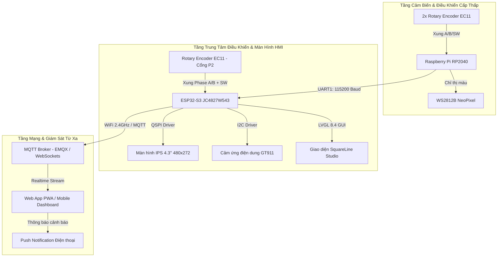

# 📋 TỔNG HỢP TẤT CẢ TÍNH NĂNG DỰ ÁN CF_IOT

> **Dự án:** Hệ thống Giám Sát & Điều Khiển Nhiệt Độ Thông Minh CF_IOT  
> **Cập nhật ngày:** 06/09/2026  
> **Kiến trúc hệ thống:** Tích hợp 3 tầng gồm **Màn hình cảm ứng ESP32-S3**, **Vi điều khiển phụ trợ RP2040**, và **Ứng dụng Web PWA (Realtime Dashboard)**.

---

## 📑 MỤC LỤC
1. [Kiến trúc Tổng thể Hệ thống](#1-kiến-trúc-tổng-thể-hệ-thống)
2. [Module 1: Mạch Màn Hình Cảm Ứng ESP32-S3 (Embedeed)](#2-module-1-mạch-màn-hình-cảm-ứng-esp32-s3-embedeed)
3. [Module 2: Mạch Vi Điều Khiển Phụ Trợ RP2040 (CP2040)](#3-module-2-mạch-vi-điều-khiển-phụ-trợ-rp2040-cp2040)
4. [Module 3: Ứng Dụng Giám Sát Web Dashboard (PWA)](#4-module-3-ứng-dụng-giám-sát-web-dashboard-pwa)
5. [Sơ Đồ Đấu Nối & Bảng Chân Phần Cứng (Pinout)](#5-sơ-đồ-đấu-nối--bảng-chân-phần-cứng-pinout)
6. [Hướng Dẫn Vận Hành & Biên Dịch](#6-hướng-dẫn-vận-hành--biên-dịch)

---

## 1. KIẾN TRÚC TỔNG THỂ HỆ THỐNG



---

## 2. MODULE 1: MẠCH MÀN HÌNH CẢM ỨNG ESP32-S3 (Embedeed)

### 2.1. Phần Cứng & Màn Hình
- **Bo mạch điều khiển:** Guition JC4827W543 tích hợp vi điều khiển **ESP32-S3-WROOM-1** (Dual-Core 240MHz, 8MB Flash, 8MB PSRAM ngoài).
- **Màn hình LCD:** Kích thước **4.3 inch IPS**, độ phân giải **480x272**, điều khiển qua giao tiếp **QSPI** (Driver NV3041A) với Canvas PSRAM vẽ mượt mà, không bị xé hình.
- **Cảm ứng:** Cảm ứng điện dung **GT911** đa điểm qua I2C (đã cân chỉnh ma trận tọa độ, hỗ trợ lật trục X/Y chuẩn theo hướng màn hình).

### 2.2. Giao Diện Đồ Họa HMI (LVGL 8.4 + SquareLine Studio)
- **Độ sâu màu:** 32-bit màu chân thực, tối ưu chuyển đổi sang 16-bit RGB565.
- **Giao diện nền tối (Dark Theme):** Ép nền đen tuyền (`#000000`) tăng độ tương phản và bảo vệ màn hình.
- **Hiển thị nhiệt độ chính:**
  - Nhãn `ui_Temperture1` sử dụng **phông chữ lớn 85px (`ui_font_Font85`)**.
  - Màu xanh Neon nổi bật, hiển thị số thực với 1 chữ số thập phân (ví dụ: `85.4°C`).
- **Thanh đo Arc kép (Dual Circular Sliders):**
  - **Arc Min bên trái (`ui_ArcMin` & `ui_TemperatureMin`):** Giới hạn từ **20°C đến 120°C**, mặc định ban đầu **50°C**.
  - **Arc Max bên phải (`ui_ArcMax` & `ui_TemperatureMax`):** Giới hạn từ **40°C đến 140°C**.
  - Thao tác kéo cảm ứng trực tiếp trên màn hình hoặc vặn núm xoay cơ học để thay đổi ngưỡng.
- **Biểu đồ sóng nhiệt độ Realtime (`ui_Chart1`):**
  - Cấu hình **30 điểm dữ liệu (Samples)**.
  - Chế độ cuộn dữ liệu trượt **FIFO (`LV_CHART_UPDATE_MODE_SHIFT`)**.
  - Chu kỳ quét: **2.0 giây / mẫu**.
  - Dải nhiệt độ trục Y: **60°C ~ 130°C**.
  - Đường vẽ màu xanh Neon (`#10B981`) liền mạch.

### 2.3. Giải Mã 2 Núm Xoay Vô Cấp Rotary Encoder EC11 (Cổng P2 & Cổng P3)
Hệ thống hỗ trợ đồng thời **2 núm xoay vô cấp EC11** cắm trực tiếp vào 2 cổng SH1.0 có sẵn trên bo mạch:

* **Núm xoay EC11 #1 (Cổng P2) - Điều khiển Ngưỡng Thấp (Min Temperature):**
  - **Pin 1 (SW)**: `GPIO 46` *(Nút nhấn, reset về 50°C)*
  - **Pin 2 (GND)**: `GPIO 9` *(Cấp mức LOW 0V làm cực Mass)*
  - **Pin 3 (Phase A)**: `GPIO 14` *(CLK)*
  - **Pin 4 (Phase B)**: `GPIO 5` *(DT)*
  - **Chức năng**: Xoay thuận (phải) tăng Min Temp, xoay ngược (trái) giảm Min Temp (`20°C ~ 120°C`). Bấm nút SW reset về `50°C`.

* **Núm xoay EC11 #2 (Cổng P3) - Điều khiển Ngưỡng Cao (Max Temperature):**
  - **Pin 1 (SW)**: `GPIO 6` *(Nút nhấn, reset về 100°C)*
  - **Pin 2 (GND)**: `GPIO 7` *(Cấp mức LOW 0V làm cực Mass)*
  - **Pin 3 (Phase A)**: `GPIO 15` *(CLK)*
  - **Pin 4 (Phase B)**: `GPIO 16` *(DT)*
  - **Chức năng**: Xoay thuận (phải) tăng Max Temp, xoay ngược (trái) giảm Max Temp (`40°C ~ 140°C`). Bấm nút SW reset về `100°C`.

* **Đặc tính kỹ thuật chung:**
  - **Hoạt động độc lập:** Xoay tự do trực tiếp không cần phải ấn giữ nút SW.
  - **Bộ lọc chống dội cơ học (Hardware Debounce Filter):** Lọc triệt để nhiễu cơ học dưới **800µs** và giải mã máy trạng thái 4 bước (Finite State Machine), bước xoay cực đầm, chính xác 1 khấc = đúng 1 đơn vị (°C).

### 2.4. Trình Quản Lý & Cài Đặt WiFi Trực Tiếp (WiFi GUI Manager)
- **Nút mở tiện ích:** Icon sóng WiFi (`📶`) nổi ở cạnh đáy màn hình cảm ứng.
- **Hộp thoại Modal chuyên nghiệp (460x245px):**
  - **Nút Scan WiFi (`LV_SYMBOL_REFRESH`):** Tự động quét các mạng xung quanh trong tích tắc và nạp vào danh sách thả xuống (Dropdown list).
  - **Dropdown chọn SSID:** Người dùng chỉ cần chạm để chọn mạng cần kết nối.
  - **Ô nhập Mật khẩu (`Password Textarea`):** Chế độ ẩn ký tự bảo mật (`●●●●●●`).
  - **Bàn phím ảo cảm ứng (LVGL Virtual Keyboard):** Tự động đẩy lên lớp trên cùng khi nhấn vào ô mật khẩu, kích thước rộng rãi dễ gõ bằng ngón tay.
  - **Trạng thái & Báo IP:** Tự động kết nối, thử lại và hiển thị thông báo địa chỉ IP khi thành công (`Connected! IP: 192.168.x.x`).

### 2.5. Giao Tiếp Công Nghiệp Modbus RTU Master (Poll) Trên UART1
- **Cổng phần cứng:** `TX: GPIO 17`, `RX: GPIO 18`, Baud rate: `115200 bps` (8N1).
- **Cổng COM kết nối máy tính:** **`COM3`** *(qua mạch chuyển đổi USB-to-TTL)*.
- **Vai trò:** **Modbus RTU Master (Client / Poll)** (Đọc Target **Slave ID: 1**, chu kỳ **500 ms**).
- **Mã hàm thực thi:**
  - **FC03** (Read Holding Registers): ESP32 chủ động đọc định kỳ thanh ghi `40001 ~ 40005` từ Slave (phần mềm **ModSim32** trên PC hoặc PLC).
  - **FC06** (Write Single Register): ESP32 chủ động ghi giá trị mới xuống Slave khi người dùng vặn núm xoay hoặc bấm nút reset.
- **Bảng thanh ghi tương tác với ModSim32 (Holding Registers):**
  - **`40001`**: Nhiệt độ đo tức thời x10 (ví dụ `854` = **85.4°C**). ESP32 đọc định kỳ từ ModSim32, cập nhật số to ở giữa màn hình (`ui_Temperture1`) và vẽ biểu đồ sóng (`ui_Chart1`).
  - **`40002`**: Ngưỡng nhiệt độ Min (`20 ~ 120°C`). Khi vặn núm **P2** hoặc bấm nút reset 50°C, ESP32 gửi lệnh FC06 cập nhật ngay vào ô `40002` của ModSim32.
  - **`40003`**: Ngưỡng nhiệt độ Max (`40 ~ 140°C`). Khi vặn núm **P3** hoặc bấm nút reset 100°C, ESP32 gửi lệnh FC06 cập nhật ngay vào ô `40003` của ModSim32.
  - **`40004`**: Trạng thái cảnh báo (`0`: Bình thường, `1`: Dưới Min, `2`: Quá nhiệt).
- **Phân biệt cổng COM trên máy tính:**
  - **`COM9` (Cổng USB-C)**: Nạp code firmware và theo dõi log debug LVGL.
  - **`COM3` (Cổng UART1 Modbus Master)**: Kết nối ModSim32 (Slave Simulator trên PC) hoặc thiết bị công nghiệp.

### 2.6. Môi Trường Mô Phỏng Trên Máy Tính (LVGL PC Simulator)
- Thư mục mã nguồn tích hợp sẵn kịch bản chạy **SDL2** trên Windows.
- Hỗ trợ biên dịch và gỡ lỗi trực tiếp bằng **VS Code + GDB (F5)** hoặc dòng lệnh `CMake / MinGW`.
- Kịch bản `setup.bat` tự động tải LVGL v8.3.11 khi cài đặt trên máy mới.

---

## 3. MODULE 2: MẠCH VI ĐIỀU KHIỂN PHỤ TRỢ RP2040 (CP2040)

- **Vi điều khiển:** Raspberry Pi RP2040 dual-core ARM Cortex-M0+.
- **Quản lý 2 Núm Xoay Độc Lập (ENC1 & ENC2):**
  - `ENC1`: Phase A (`GP0`), SW (`GP1`), Phase B (`GP2`).
  - `ENC2`: Phase A (`GP3`), SW (`GP4`), Phase B (`GP5`).
  - Sử dụng ngắt ngoài (`attachInterrupt`) trên các chân pha với thuật toán đọc quadrature có chống dội phím nhấn (`debounceDelay = 50ms`).
  - Nút bấm SW trên từng núm dùng để reset giá trị nấc xoay về 0.
- **Đèn Báo Đa Sắc NeoPixel (WS2812B RGB LED):**
  - Điều khiển chân dữ liệu `GP16`.
  - Hiệu ứng thị giác theo hành động:
    - **Xanh dương (Blue):** ENC1 xoay tăng.
    - **Xanh lơ (Cyan):** ENC1 xoay giảm.
    - **Tím hồng (Magenta):** ENC2 xoay tăng.
    - **Cam sáng (Orange):** ENC2 xoay giảm.
    - **Vàng (Yellow):** Cả 2 encoder cùng vượt ngưỡng tác động (`THRESHOLD = 10`).
    - **Xanh lá / Đỏ:** Báo ngưỡng độc lập từng encoder.
    - Tự động tắt LED sau 3 giây không hoạt động (`LIGHT_TIMEOUT`).
- **Giao tiếp truyền dữ liệu sang ESP32:**
  - Cổng UART phần cứng (`UART_TX: GP12`, `UART_RX: GP13`, Baud `115200`).
  - Định dạng chuỗi gửi tức thời: `E1:<val1>,E2:<val2>\n`.

---

## 4. MODULE 3: ỨNG DỤNG GIÁM SÁT WEB DASHBOARD (PWA)

### 4.1. Công Nghệ Nền Tảng PWA (Progressive Web App)
- **Cài đặt như App Native:** Có file `manifest.json` đầy đủ icon chuẩn 512x512, tên ứng dụng, màu chủ đề Cyan `#00d4aa`. Có thể cài đặt (Add to Home Screen) lên điện thoại Android, iPhone, iPad hoặc máy tính bảng/PC.
- **Hoạt động Offline:** Tích hợp `sw.js` (Service Worker) lưu trữ bộ nhớ đệm (Cache Storage). Khởi động ứng dụng tức thì ngay cả khi mất mạng.

### 4.2. Giao Diện Người Dùng (UI/UX)
- **Phong cách thiết kế:** Dark Theme hiện đại kết hợp hiệu ứng kính mờ (**Glassmorphism** với `backdrop-filter`).
- **Khả năng tương thích (Responsive Design):**
  - Màn hình lớn/Desktop: Thanh điều hướng bên trái (**Sidebar** tinh gọn, căn sát viền trên).
  - Màn hình điện thoại/Tablet: Thanh điều hướng phía dưới (**Bottom Navigation Bar**) thuận tiện thao tác 1 tay.
- **Kiến trúc SPA (Single Page Application):** Chuyển trang tức thời không cần tải lại trình duyệt.

### 4.3. Các Trang Chức Năng Chính

#### 1. Trang Giám Sát (Dashboard):
- **Cụm hiển thị chuẩn HMI LVGL:**
  - **Vòng Arc Min bên trái:** Hiển thị ngưỡng nhiệt độ thấp (màu xanh dương). Nhấp chuột để đổi giá trị.
  - **Số nhiệt độ tức thời ở giữa:** Hiển thị số siêu lớn phong cách Neon Green với hiệu ứng đổ bóng phát sáng (`text-shadow`), tự động nhảy số theo chu kỳ đo.
  - **Vòng Arc Max bên phải:** Hiển thị ngưỡng nhiệt độ cao (màu xanh lá/vàng). Nhấp chuột để đổi giá trị.
  - **Huy hiệu trạng thái (Status Badge):** Tự động chuyển đổi giữa *Bình thường* (Xanh) - *Quá nhiệt* (Đỏ) - *Dưới ngưỡng* (Cam).
- **Bộ Thống Kê Phiên Đo:**
  - Nhiệt độ **Thấp nhất (Min)**.
  - Nhiệt độ **Trung bình (Avg)**.
  - Nhiệt độ **Cao nhất (Max)**.
- **Biểu Đồ Nhiệt Độ Động (Canvas Chart):**
  - Vẽ đồ thị realtime dạng dải sóng phủ gradient màu.
  - Hỗ trợ các nút lọc khoảng thời gian: **1 Giờ (1H)**, **6 Giờ (6H)**, và **24 Giờ (24H)**.

#### 2. Trang Lịch Sử Nhiệt Độ (History):
- Bảng nhật ký ghi nhận đầy đủ các mốc dữ liệu:
  - Cột thời gian (Giờ : Phút : Giây).
  - Cột giá trị nhiệt độ (°C).
  - Cột trạng thái (Bình thường / Cảnh báo).
  - Cột so sánh tương quan với ngưỡng Min và Max đã thiết lập.

#### 3. Trang Cảnh Báo (Alerts):
- Danh sách tập trung toàn bộ các sự kiện vi phạm ngưỡng:
  - Cảnh báo **VƯỢT NGƯỠNG CAO (Overheat Alert)** khi nhiệt độ vượt Max.
  - Cảnh báo **DƯỚI NGƯỠNG THẤP (Under-temperature Alert)** khi nhiệt độ tụt dưới Min.
- Tích hợp **Web Notification API**: Gửi thông báo rung và chuông cảnh báo ra màn hình khoá điện thoại ngay cả khi người dùng không mở tab trình duyệt.

#### 4. Trang Cài Đặt (Settings):
- **Lựa chọn nguồn dữ liệu linh hoạt:**
  - `📡 Máy chủ Thực tế (MQTT)`: Nhận dữ liệu thực tế từ ESP32 qua mạng Internet.
  - `🧪 Dữ liệu Mô phỏng (Simulated)`: Chế độ giả lập tạo dữ liệu ngẫu nhiên để thử nghiệm và demo tính năng mà không cần kết nối phần cứng.
- **Cấu hình MQTT Broker:**
  - Máy chủ (Host): Mặc định `broker.emqx.io` (hoặc IP Broker nội bộ).
  - Cổng (Port): `8083` (WebSocket) / `8084` (WSS bảo mật).
  - Topic nhận dữ liệu: `cf_iot/temperature`.
  - Tên đăng nhập & Mật khẩu (Auth tùy chọn).
- **Các nút chức năng nhanh:**
  - `💾 Lưu Cài đặt & Kết nối`: Lưu cấu hình vào LocalStorage và khởi động lại luồng dữ liệu.
  - `📡 Gửi dữ liệu thử nghiệm`: Test nhanh luồng nhận tin nhắn.
  - `🧪 Kích hoạt Chế độ Mô phỏng Ngay`: Bật nhanh máy phát tín hiệu giả lập.
  - `🔔 Bật Thông báo Cảnh báo về Điện thoại`: Cấp quyền nhận thông báo Push Notification.

---

## 5. SƠ ĐỒ ĐẤU NỐI & BẢNG CHÂN PHẦN CỨNG (PINOUT)

### 5.1. Mạch JC4827W543 (ESP32-S3)
| Thiết bị / Module | Tên Chân | Chân ESP32-S3 | Chức Năng |
| :--- | :--- | :--- | :--- |
| **Rotary Encoder EC11 #1** | **Chân 1 (SW)** | `GPIO 46` | Nút nhấn (Reset Min về 50°C) |
| *(Cổng P2 - Chỉnh Min)* | **Chân 2 (GND)** | `GPIO 9` | Cấp mức 0V (Output LOW) |
| | **Chân 3 (Phase A)** | `GPIO 14` | Xung Quadrature A (CLK) |
| | **Chân 4 (Phase B)** | `GPIO 5` | Xung Quadrature B (DT) |
| **Rotary Encoder EC11 #2** | **Chân 1 (SW)** | `GPIO 6` | Nút nhấn (Reset Max về 100°C) |
| *(Cổng P3 - Chỉnh Max)* | **Chân 2 (GND)** | `GPIO 7` | Cấp mức 0V (Output LOW) |
| | **Chân 3 (Phase A)** | `GPIO 15` | Xung Quadrature A (CLK) |
| | **Chân 4 (Phase B)** | `GPIO 16` | Xung Quadrature B (DT) |
| **Màn hình NV3041A** | CS / SCK / D0-D3 | `IO 45, 47, 21, 48, 40, 39` | Giao tiếp QSPI tốc độ cao |
| **Đèn nền & Nguồn** | BL / PWR | `GPIO 1, 2, 38` | Cấp nguồn và độ sáng màn hình |
| **Cảm ứng GT911** | SDA / SCL / INT / RST | `IO 8, 4, 3, 38` | Giao tiếp I2C cảm ứng điện dung |
| **Cổng UART1** | TX1 / RX1 | `GPIO 17 / GPIO 18` | Nhận dữ liệu từ RP2040 (115200) |

### 5.2. Mạch RP2040 (Coprocessor)
| Thiết bị / Module | Tên Chân | Chân RP2040 | Ghi Chú |
| :--- | :--- | :--- | :--- |
| **Encoder 1 (ENC1)** | Phase A / SW / Phase B | `GP0`, `GP1`, `GP2` | Đo xung núm vặn 1 |
| **Encoder 2 (ENC2)** | Phase A / SW / Phase B | `GP3`, `GP4`, `GP5` | Đo xung núm vặn 2 |
| **LED WS2812B** | DI (Data In) | `GP16` | LED đa sắc báo trạng thái |
| **Cổng UART1** | TX / RX | `GP12 / GP13` | Nối sang GPIO 18 / 17 của ESP32 |

---

## 6. HƯỚNG DẪN VẬN HÀNH & BIÊN DỊCH

### 6.1. Nạp Firmware ESP32-S3 (Embedeed)
Sử dụng PlatformIO trong VS Code hoặc Terminal:
```bash
# Biên dịch và nạp chương trình lên cổng COM (ví dụ COM9):
pio run -d "d:\Project\CF_IOT\Embedeed" -t upload

# Mở Serial Monitor theo dõi:
pio device monitor -p COM9 -b 115200
```

### 6.2. Nạp Firmware RP2040 (CP2040)
Mở tệp `CP2040/CP2040.ino` bằng Arduino IDE hoặc VS Code:
1. Chọn Board: **Raspberry Pi Pico / RP2040**.
2. Cài đặt thư viện: `Adafruit NeoPixel`.
3. Nhấn **Upload** để nạp firmware.

### 6.3. Khởi Chạy Ứng Dụng PWA (Web Dashboard)
1. Mở Terminal tại thư mục `PWA/`:
   ```bash
   cd d:\Project\CF_IOT\PWA
   node server.js
   ```
2. Truy cập trình duyệt:
   - Bản HTTP thông thường: `http://localhost:8080` (hoặc IP máy tính trong mạng LAN: `http://<IP_MAY_TINH>:8080`).
   - Bản HTTPS (để test Service Worker trên điện thoại): `https://localhost:8443`.
3. Nhấn vào biểu tượng **"Cài đặt ứng dụng"** trên thanh địa chỉ của Chrome/Edge/Safari để đưa ứng dụng ra màn hình chính.
